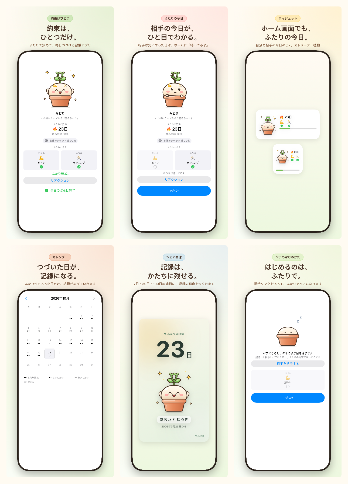

# App Store スクリーンショット — v4「タネの子」(MK7 / issue #80)

G4(#42)の承認材料。**実際の画面**(アプリの本物の SwiftUI View)を CI のシミュレータで描き、
キャプションと合成したもの。手で描いた画面・モック・実在しない機能は入っていない。

- 6.7インチ(1290×2796)6枚 / 6.1インチ(1179×2556)6枚
- 文言の正本: [`captions.json`](captions.json)(mkt-exec と共有)
- 設計の理由: [`plan.md`](plan.md)
- 生成の記録: [`manifest.json`](manifest.json)(どの captions.json から、どの CI 実行で作ったか)



## 1. 6枚

| # | コピー | 見せている画面 | 根拠 | 6.7in | 6.1in |
|---|---|---|---|---|---|
| 1 | 約束は、ひとつだけ。 | ホーム(ふたり達成・23日・チケット2枚) | CONCEPT §5 / REQUIREMENTS §3.4 | [PNG](6.7in/01_home_both.png) | [PNG](6.1in/01_home_both.png) |
| 2 | 相手の今日が、ひと目でわかる。 | ホーム(相手だけ完了 →「ゆうきが待ってるよ」) | REQUIREMENTS §3.10 | [PNG](6.7in/02_home_waiting.png) | [PNG](6.1in/02_home_waiting.png) |
| 3 | ホーム画面でも、ふたりの今日。 | ウィジェット(中・小)の実描画 | REQUIREMENTS §3.10 / T17a | [PNG](6.7in/03_widget.png) | [PNG](6.1in/03_widget.png) |
| 4 | つづいた日が、記録になる。 | カレンダー履歴(2026年10月) | REQUIREMENTS §3.11 / T18 | [PNG](6.7in/04_history.png) | [PNG](6.1in/04_history.png) |
| 5 | 記録は、かたちに残せる。 | シェア画像(9:16)の実描画 | REQUIREMENTS §3.13 / T22 | [PNG](6.7in/05_share.png) | [PNG](6.1in/05_share.png) |
| 6 | はじめるのは、ふたりで。 | ソロのホーム(タネの子・招待) | REQUIREMENTS §3.2 / T11 | [PNG](6.7in/06_home_solo.png) | [PNG](6.1in/06_home_solo.png) |

コピーの根拠(`claim`)は `captions.json` にフレームごとに書いてある。mkt-review はそこを確認する。

## 2. どうやって作ったか(実際の画面と違う画像を作らないために)

1. `LienTests/StoreScreenshotRenderTests` が、本物の View を端末と同じポイント数・3倍で描く
   - ホーム: `SnapshotContent`(HomeView の中身)を、HomeView と同じ余白(24pt)で。
     `ImageRenderer` は `ScrollView` を描けないため、スクロールの器だけを外す(先頭位置の見た目と同じ)
   - カレンダー: `HistoryView(viewModel:scrolls:autoload:)` の `scrolls: false, autoload: false`
   - ウィジェット: `WidgetRootView`(中・小)を実寸で
   - シェア画像: `ShareImageCardView`(9:16)を実寸で
2. `StoreScreenshotFrames` が、キャプション([`captions.json`](captions.json))と端末枠に合成する
3. 出力: 6.7in = 1290×2796 / 6.1in = 1179×2556。PNG・アルファなし(CI の artifact `store-screenshots`)

**描かないもの**: ステータスバー・ナビゲーションバー(OS が描く)、ホーム画面の壁紙・他のアプリのアイコン、
実在しない画面・機能・数字。ウィジェットはウィジェット自身の実描画で、ホーム画面の見た目は作っていない。

デモデータは固定(あおい / ゆうき、筋トレ / ランニング、ふたりの記録 23日、植物は段階3「みどり」、
チケット残り2枚、10/8 はお休み・10/13 は途切れ)。`StoreDemo`(テスト内)が正本。

## 3. 生成の記録

| 項目 | 値 |
|---|---|
| 生成 | `manifest.json` の `generatedAt`(Asia/Tokyo) |
| CI 実行 | [lien-ios #39389661638](https://github.com/Ryoki63/Challenge/actions/runs/39389661638)(2026-10-20。main 取り込み後) |
| コミット | `manifest.json` の `provenance.commit`(`c308e5c`。この画像を描いたテストの版) |
| キャプションの SHA-256 | `manifest.json` の `captionsSHA256`(いまの `captions.json` と一致すること) |
| artifact | `store-screenshots`(完成画像 + raw/ + manifest + 一覧) |

## 4. 再生成の手順

キャプションを変えたら、**画像も作り直す**(`verify_screenshots.py` がずれを止める)。

```bash
# 1. 文言を直す(正本)
$EDITOR products/lien/marketing/screenshots/captions.json

# 2. CI で描く(products/lien/ios/** を触っていれば push で lien-ios が走る。
#    文言だけのときは workflow_dispatch で lien-ios を回す)
gh workflow run lien-ios.yml --repo Ryoki63/Challenge --ref <branch>
gh run list --repo Ryoki63/Challenge --workflow=lien-ios.yml --limit 3

# 3. artifact を取る
gh run download <run-id> --repo Ryoki63/Challenge -n store-screenshots -D /tmp/store

# 4. 差し替える(raw/ と ci.json はコミットしない)
cp /tmp/store/6.7in/*.png        products/lien/marketing/screenshots/6.7in/
cp /tmp/store/6.1in/*.png        products/lien/marketing/screenshots/6.1in/
cp /tmp/store/manifest.json      products/lien/marketing/screenshots/
cp /tmp/store/contact-sheet-6.7in.png products/lien/marketing/screenshots/

# 5. 検査してコミット
cd products/lien/marketing && python3 tools/verify_screenshots.py
```

- 画像を作り直さずに `captions.json` だけ変えると、`manifest.json` の SHA-256 が合わずに CI が落ちる
- 6.7in / 6.1in のどちらかだけを差し替えない(2サイズは同じ実行で作る)

## 5. 検査

| 検査 | 場所 | 内容 |
|---|---|---|
| 実描画・空でないこと・文言の長さ | `LienTests/StoreScreenshotRenderTests`(CI `lien-ios`) | 本物の View から描く。1枚ごとに空でないことを画素で確認。見出し2行・13文字まで、サブ28文字まで、禁止表現なし、claim が空でないこと |
| 寸法・アルファなし・キャプションとの一致 | `marketing/tools/verify_screenshots.py`(CI `lien-ci` の `store-metadata`) | 6.7in / 6.1in 各6枚、1290×2796 / 1179×2556、color type 0/2、manifest の SHA-256、余計な PNG が無いこと、一覧画像の有無 |
| 文言の罰なし lint | `StringsReviewTests`(CI `lien-ios`) | `Strings.swift` の全文言。画像のコピーは `captions.json` 側でも禁止表現を検査 |

## 6. 注意

- 10/24 の機能凍結後に UI が変わったら、この手順で作り直す(10/26 の G4 までに確定する)
- 実機での見え方(ステータスバー・ナビゲーションバーを含む)は T20 / G4 の最終確認で見る。
  この画像はアプリの View だけを描いたもので、OS が描く部分は含まない
- 旧 T26 の下絵(ドット絵・M ウィジェット+相手の写真)と `gen_screenshot_svg.py` は廃止した。
  必要なら git の履歴から参照する
